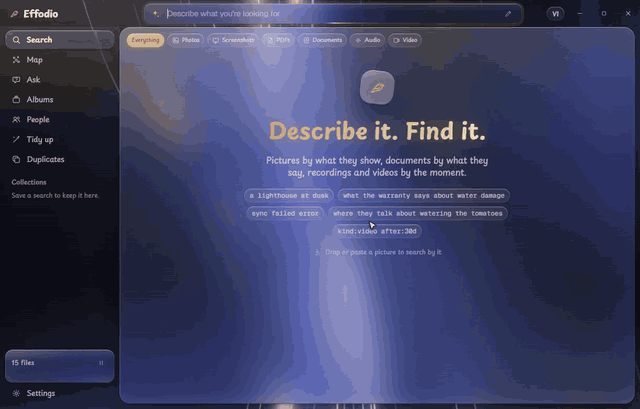
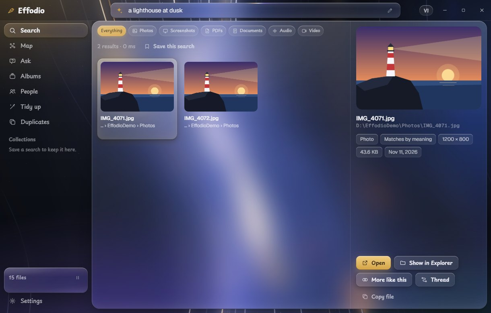
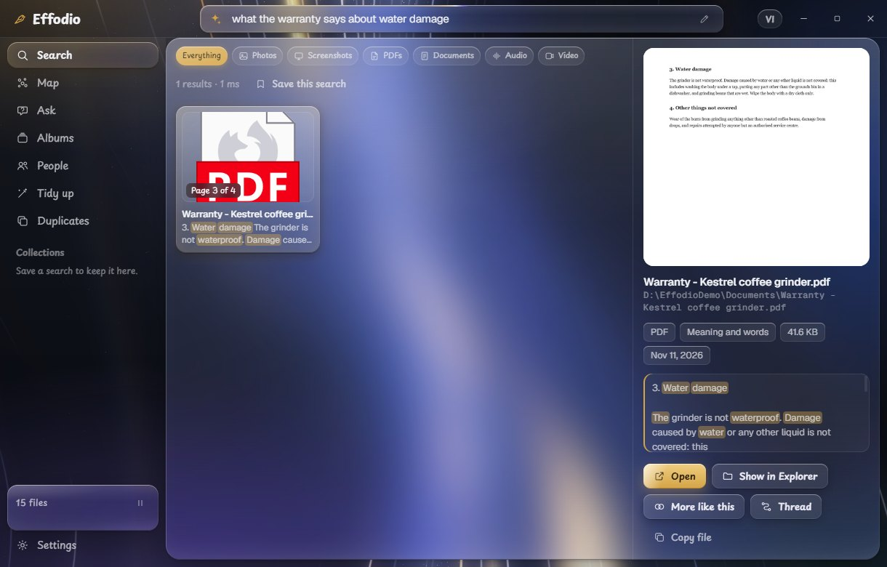
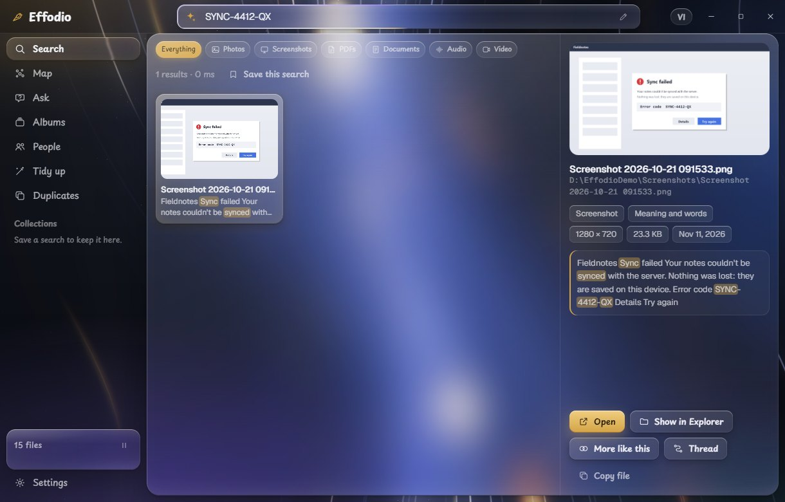
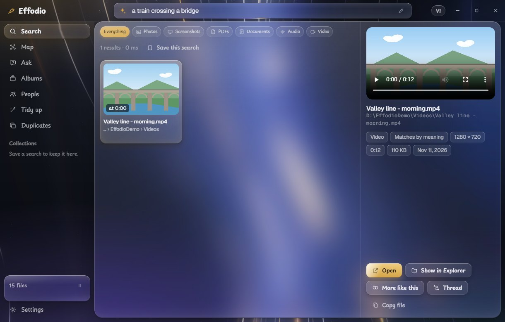
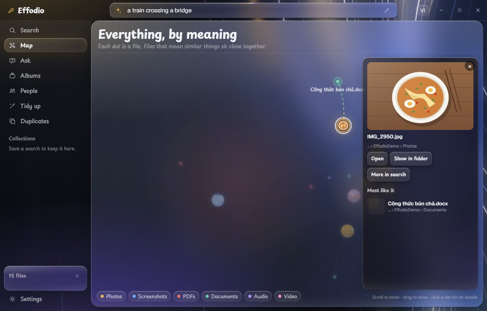
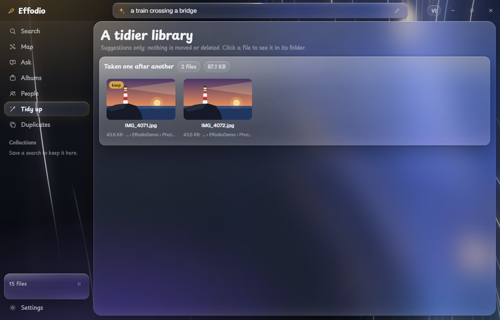
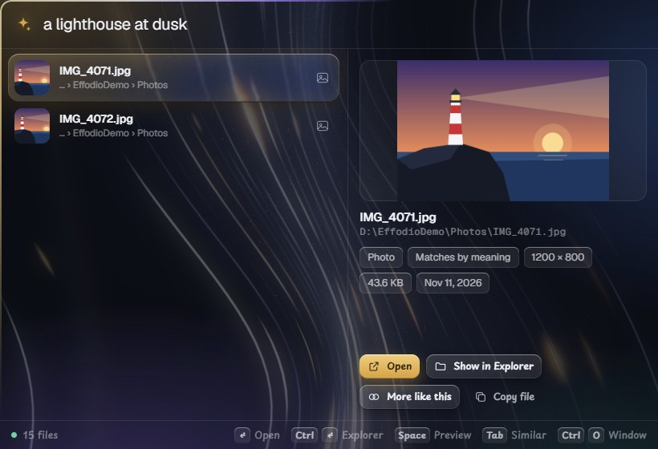

<p align="center"></p>

# Effodio

**Describe it. Find it.** Effodio searches the files on your computer by what's in them: a photo by what it shows, a
PDF by what a page says, a recording or a video by the moment. Everything runs on your computer.

*Effodio* is Latin for "I dig out". It's for Windows 10 and 11 (64-bit). A Mac version is planned.

[](https://effodio.nhaajt.com)

That's the start of the tour; the whole of it plays on [effodio.nhaajt.com](https://effodio.nhaajt.com)
([the video file](site/demo.mp4)). The pictures, the clip and the papers in it, and in the screenshots below, were
made for the tour: none of them is anyone's real file.

```
"a lighthouse at dusk"                        the photo
"a train crossing a bridge"                   the clip, at the second the train comes on
"what the warranty says about water damage"   the PDF, at page 3
"sync failed error"                           the screenshot, by the text in it
"hoa don tien nuoc"                           "Hóa đơn tiền nước tháng 9.pdf" (accents are optional)
"SYNC-4412-QX"                                an exact code, wherever it's written, pictures included
```

## A look around

**Say what the picture shows.** No tags, no file names: the words are matched against what's in the photo.



**To the page.** A long document is read in pieces, so the result is the page that answers, and it opens there.



**Words inside pictures count.** Text in screenshots and scans is read by Windows' own OCR, so a code that only
exists in a picture is still found.



**To the moment.** A video or a recording opens at the second that matched.



**The map.** Every file is a dot, placed by meaning. Pick one to see what it is and what's most like it, without
leaving the map.



**A tidier library.** Bursts taken one after another, copies and near-copies, each with a suggestion of which to
keep. Suggestions only: nothing is moved or deleted.



**From any app.** Ctrl+Shift+Space opens a small panel over whatever you're doing.



## What it does

**Search**

- **One search for every kind of file.** Pictures, screenshots, PDFs (scans too), Word, Excel, PowerPoint and
  OpenDocument files, text and Markdown, e-books, audio and video. The model puts text, pictures and sound in one
  space, in more than 100 languages, so a search in English can find a note written in Vietnamese.
- **To the page, the passage, the moment.** Long files are read in pieces; a result opens where it matched. A strip
  under a recording or a video shows every place the search matches.
- **Exact words count too.** Names, numbers and codes are matched as written, in file names, document text, and the
  text Windows reads in pictures and scans.
- **Search by example.** Drop or paste a picture, press Tab on a result, or draw a rough sketch, to find what's
  like it.
- **Filters you type.** `kind:video`, `in:Downloads`, `ext:pdf`, `after:2026-10`, `after:30d`, `"exact words"`,
  `-word` to steer away from something, `color:blue` for the main colour of a picture, `subject:left` for where its
  subject sits, and `person:` with a name you've given.
- **Saved searches** stay in the sidebar and say when something new matches.

**People** (off until you turn it on)

- Name a face once, in any photo; from then on typing the name finds that person.
- Or give it a photo and it finds the others with the same face.
- Drag one person onto another to join two groups that are the same person.

**Other ways in**

- **The map**, described above.
- **Albums that make themselves**, gathered from what the photos show.
- **The thread**: from one file, on through the files most like it.
- **Tidy-up and duplicates**: bursts, exact copies, and pictures that are mostly the same (resized, recompressed,
  lightly edited).
- **Ask your files**: a question answered from what your files say, with the sources beside it. The language model
  runs on your computer and is a download you ask for.
- **Words spoken in recordings and videos**: also a download you ask for; after it, you can search for what was said.
- **Ctrl+K** in the window: every place and action, found by typing.
- **A local search door for your own tools**, off unless you open it (see below).

The interface is in English and Vietnamese.

## Install

```powershell
powershell -c "irm https://effodio.nhaajt.com/install.ps1 | iex"
```

That downloads the installer from [effodio.nhaajt.com](https://effodio.nhaajt.com), checks its SHA-256 and installs it for
the current user. Run it again to update. The installer can also be downloaded from the site and run by hand.

Press **Ctrl+Shift+Space** in any app for the search panel.

| Key | What it does |
|---|---|
| ↓ ↑ | Move through the results |
| Enter | Open the result: a PDF at its page, a recording or video at its moment |
| Ctrl+Enter | Show it in Explorer |
| Space | A large preview (once you've moved to a result) |
| Tab | More like this |
| Ctrl+C | Copy the file |
| Ctrl+O | The same search in the window |
| Esc | Clear, then close |

## How it works

```
your folders ─► readers turn files into pictures, text and sound
             ─► EmbeddingGemma 2 on llama.cpp, in a helper process that quits when it's done
             ─► one SQLite file: a vector for every picture, page, passage, video frame and 30 s of sound,
                plus a keyword index of names and text
your words   ─► the model's text part (while you search) ─► nearest vectors + exact words
```

Every piece of a file gets a point with its place in the file. A search scores every point against your words and
puts each on a scale of how far it stands out from the others of its kind, so a photo and a PDF page can be ranked
together; words found in the file add to that. Results that trail far behind the best are folded under "weaker
matches", and a search for something that isn't there says so.

Files are read by Windows itself where it has a reader: its OCR for text in pictures, its PDF renderer for scanned
pages, its codecs for HEIC and RAW. Audio and video go through FFmpeg, running as a separate process.

The index remembers which model and vector version made it, and never mixes them. A test checks that this build's
vectors match stored reference vectors (cosine ≥ 0.999) before anything else is trusted.

## Build

You'll need Rust, Node 20 or later, Python 3, Git and Visual Studio's C++ build tools.

```bat
git clone --depth 1 --branch b11461 https://github.com/ggml-org/llama.cpp vendor\llama.cpp
python -m venv vendor\tools-venv && vendor\tools-venv\Scripts\pip install cmake ninja
scripts\build-llama.cmd cpu
cargo test --release
pwsh scripts\package.ps1
```

The installer lands in `target\release\bundle\nsis`. It installs for the current user, with no administrator
rights. It isn't signed, so Windows asks before running it: More info, then Run anyway.

To work on it: `cargo build -p effodio-helper`, then `cd app && npx tauri dev`.

**FFmpeg.** Recordings and videos need `ffmpeg` and `ffprobe` on the PATH or beside `effodio.exe`
(`winget install Gyan.FFmpeg`). Without them everything else still works, and Settings says so.

**Graphics card.** The app runs the model on the processor unless a GPU build of llama.cpp is beside it and the speed
check finds it faster with the same vectors. To build one, install the Vulkan SDK (or run
`scripts\build-vulkan-deps.cmd`, which builds what's needed from source), then `scripts\build-llama.cmd vulkan` and
`pwsh scripts\package.ps1 -Flavor vulkan`.

## The local search door

Off by default. Switched on in Settings, it lets other programs on the same computer search the index:

```sh
curl -H "Authorization: Bearer <token>" "http://127.0.0.1:47600/search?q=lighthouse+at+dusk&limit=5"
```

After that: only this computer can reach it (it listens on 127.0.0.1, never on the network); every request needs the
token from Settings; it answers `GET /search` and `GET /status` and nothing else; it can't change or read your
files, only return what a search returns (paths, excerpts, places).

## Checking it

```sh
cargo test --release                     # the engine, and the vectors against their reference
python scripts/eval.py evals/testbed.json   # how often the right file comes first
python scripts/smoke.py                  # everything the app asks of the helper
```

`EFFODIO_HOME` points all three (and the app) at another data folder, so a test index never touches yours.

## Where things are

| | |
|---|---|
| `crates/embed` | The model on llama.cpp: text, pictures and sound into vectors |
| `crates/core` | Rules, readers, the index, the search |
| `crates/faces` | Finding faces in photos and telling them apart |
| `crates/helper` | The helper process: indexing, searching, the speed check, the model download |
| `app/src-tauri` | The app: tray, shortcut, windows, the folder watcher, the local door |
| `app/src` | The interface |
| `docs` | The pictures in this file |
| `site` | The website and the install script (`pwsh scripts\site.ps1 -Deploy` publishes them with the installer) |

Your data is in `%LOCALAPPDATA%\app.effodio.search`: the model, the index, the settings and a cache of thumbnails.
Uninstalling with "Delete the application data" ticked removes it.

## Privacy

Effodio works on your computer and keeps what it learns there.

- **Your files stay put.** Reading, indexing and searching all happen on your machine. Nothing you index is
  uploaded, and there is no account and no telemetry.
- **Faces are off until you turn them on.** With People on, Effodio finds the faces in your photos and keeps a
  short description of each in the index beside the files, on this computer only, so that a name you give once
  finds that person again. "Forget every face" in People deletes all of it, names included. If you share your
  computer or your index, the people in your photos are in it too: turn it on only where that's fine.
- **Answers and spoken words run locally.** The language model and the speech model are downloads you ask for;
  after that, questions, answers and transcripts never leave the machine.
- **When it does go online.** To download the models and tools you ask for (from Hugging Face and GitHub), and
  once at start to ask effodio.nhaajt.com for the latest version number, which sends nothing about you and can be
  switched off in Settings. The local door for other tools is off by default, listens on this computer only and
  needs a token.
- **Feedback is yours to send.** The form on the website sends only what you type into it.

It's built on [EmbeddingGemma 2](https://huggingface.co/google/embeddinggemma-2) by Google DeepMind,
[llama.cpp](https://github.com/ggml-org/llama.cpp) (MIT), [Tauri](https://tauri.app) (MIT or Apache 2.0) and
[SQLite](https://sqlite.org). Their notices are in [THIRD-PARTY-NOTICES.md](THIRD-PARTY-NOTICES.md).

Effodio isn't affiliated with Google or Microsoft.

## License

MIT
